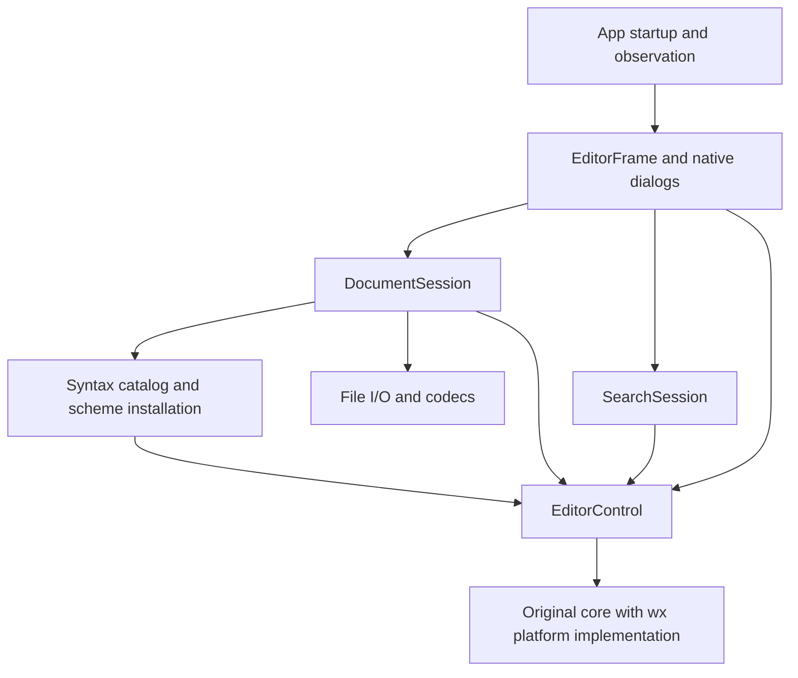

# Code structure and evolution plan

Status: proposal, based on `d52c22041b0de7995c5d578ba57c6025d56158c6`.
This document inventories the implemented code and proposes a sequence of
behavior-preserving changes. The proposed files and interfaces do not exist yet.

Keep the current original-core + wxWidgets design. Concentrate search semantics,
document transitions and language definitions in their respective modules before
adding more features. The first useful change is extracting search behavior from
`EditorFrame`; moving files alone would leave the same coupling in place.

## Current structure

| Location | Current responsibility | Assessment |
| --- | --- | --- |
| `src/main.cpp` | App startup, command-line options, process observation protocol | Startup is small; move the opt-in observer to its own implementation when reorganizing the app. |
| `src/editor_frame.*` | Menus, modeless Find/Replace UI, prompts, file-command coordination, search/replacement algorithms, language choice, title/status | Main source of mixed responsibilities. Search match validity and replacement progress currently depend directly on dialog controls. |
| `src/document_session.*` | Path, encoding/BOM, Open/New/Save transactions, save-point updates, safe replacement of disk files | Useful existing module. Preserve its commit-on-success behavior and deepen it around document-local policy. |
| `src/gbk_codec.*`, `src/utf16_codec.*` | Encoding conversions, including CP936 compatibility | Retain the tested conversions and provenance. Their implementation can continue to use wx conversion facilities. |
| `src/syntax_scheme.*`, `src/*_scheme_data.h` | Extension detection, names, fold capability, lexer/style installation, generated upstream data | Language knowledge also appears in the frame's menu and in the build/lexer registration list. A static catalog can centralize runtime definitions. |
| `src/editor_control.*` | wx window, original core lifetime, input, selection/scrolling, clipboard, IME, notifications, fold selection repair | Keep as the editor host. Extract native details internally without exposing `Scintilla::Internal` to application code. |
| `src/platform/*` | Original platform interface implementations, rendering/fonts/windows, portability primitives | Keep tightly coupled to the pinned core. This is an implementation of the existing upstream interface, not an independent replacement editor. |
| `patches/`, `tools/build.py`, `tools/update_*_scheme.py` | Pinned source preparation, portability patch, reproducible lexer data | Keep the offline path, revision/hash checks and selective upstream reuse. |
| `tests/`, `tools/clipboard_*`, `tools/resources.py` | Real editor, native UI, disk-byte and independent-process checks | Valuable behavior coverage. Many search cases currently need dialog automation to reach their logic. |

The CMake target named `editor_control` currently includes the frame, file session,
codecs, syntax and platform implementation. It is an application library, despite
its name. `notepad4_core` is a separate static target but already depends on wx
facilities through the port; it is not a toolkit-independent engine in this build.

Two useful properties already hold:

- The original core owns live UTF-8 text, history, the save point, selections,
  styling and fold state. There is no second wx text model.
- File operations return explicit success/cancellation/failure. Decoding happens
  before document replacement; disk writes finish before path/save-point updates.

`EditorControl::Send()` has a short C++ signature but a large interface: callers
must understand message ordering, byte positions, temporary-buffer lifetime,
regex capture validity and undo grouping. The goal is to concentrate those
protocols in feature implementations, rather than wrap every message individually.

## Proposed module arrangement

Arrows below denote calls/dependencies, not copies of document state. All current
editor and UI operations remain on the GUI thread.



The frame remains the composition point. A separate all-purpose application
controller would mostly relocate its current responsibilities. Native menu
bindings can stay in the frame once feature algorithms and dialog construction
have their own modules.

Proposed destinations for code already implemented:

```text
src/
  app/
    main.cpp
    editor_frame.{h,cpp}
    find_replace_dialog.{h,cpp}
    process_observer.{h,cpp}
    windows.rc
  document/
    document_session.{h,cpp}
    file_io.{h,cpp}              # private file/encoding mechanics
    encoding/
      gbk_codec.{h,cpp}
      utf16_codec.{h,cpp}
  search/
    search_session.{h,cpp}
    search_options.h
  syntax/
    syntax_catalog.{h,cpp}
    syntax_scheme.{h,cpp}
    generated/
      cpp_scheme_data.h
      python_scheme_data.h
      json_scheme_data.h
  editor/
    editor_control.{h,cpp}
    internal/                   # private host/core declarations, only as needed
    platform/
      wx_platform.cpp
      core_headers.h
      conversion_port.h
      intrinsics_port.h
      parallel_port.h
      msw_ime.cpp               # extracted when changing this implementation
      gtk_clipboard.cpp         # extracted with its ownership/reentrancy tests
patches/                        # pinned core changes and source provenance
tools/                          # build, generation and measurement entry points
tests/                          # gradual organization by tested behavior
```

These directories describe responsibility, not a requirement for one library or
abstract base class per directory. Small related implementations can remain in one
translation unit. Create each destination as its code is extracted.

## State ownership and lifetime

| State | Owner after extraction | Lifetime/rule |
| --- | --- | --- |
| Text, undo/redo, dirty/save point, EOL insertion, selection, fold visibility | Original core | One core document per existing editor window; read state through the editor. |
| Path, disk encoding, BOM, automatic/manual language choice | `DocumentSession` | Current document. Successful New/Open resets the language choice; successful Save As preserves an override. |
| Effective language | Derived from session choice + path using the syntax catalog | The UI reads it from the session. Any last-applied style cache is internal installation state, not a second owner of the user's choice. |
| Find query, replacement, options and wrap preference | `SearchSession` | Existing window/application session; survive New/Open as they do today. The dialog edits this state rather than owning the only copy. |
| Last match, empty-match progress, revision stamps | `SearchSession` | Invalidated by relevant query/options/selection/document changes and successful document replacement. A failed/cancelled file operation does not reset them. |
| Fonts, rendered geometry, native handles, clipboard publication lifetime | Editor/platform implementation | Editor/window or native ownership lifetime. Presentation uses the same layout geometry as input and hit testing. |
| Dialog visibility/focus, menu widgets, status text | App/UI | Presentation state; never authoritative text or dirty state. |

wx parent-child ownership continues to own windows. Sessions borrow the editor;
their callbacks must be disconnected before the referenced window is destroyed.
Extracted observers stop their timer on frame destruction, preserving today's
lifecycle. Future tabs or multiple views would need a separate ownership decision;
this proposal retains the present one-document window.

## The first three useful extractions

### SearchSession and FindReplaceDialog

Move `Search`, `SearchFlags`, `ReplaceOne`, `ReplaceAll`, and their match/progress
state from `editor_frame.cpp` into `SearchSession`. It operates on the real
`EditorControl`, uses the original matcher/formatter and returns structured
outcomes. It does not create widgets or set status-bar strings.

The intended interface has a small set of operations:

| Operation | Caller supplies | Caller receives |
| --- | --- | --- |
| Configure search | Query, replacement, options, wrap setting | Updated session; relevant match state invalidated |
| Find | Direction | Found/no match/invalid pattern/empty query, matched byte range and wrap status |
| Replace one | Current configured search | Whether a replacement occurred and the following search outcome |
| Replace all | Current configured search | Replacement count, whether bytes changed, or an error |

The module performs match selection and fold reveal as part of Find. Callers
should not repeat the sequence of setting core targets, validating a match,
expanding folds and scrolling the caret. Byte offsets remain UTF-8 offsets; GUI
string indices do not become document positions.

Preserve the forward scan used for backward multiline regex searches, capture
revalidation, zero-width progress, full-document replacement and no-op history
semantics. Preserve one undo group for a text-changing Replace All. Extraction
must retain these behaviors before changing an algorithm.

`FindReplaceDialog` owns its widgets and forwards requests to this same session.
F3, Shift+F3, menu items and dialog buttons share the operations. The frame formats
outcomes for the status bar; the dialog formats replacement counts. Do not build
a second search engine or copy the document into a searchable application model.

### DocumentSession as the document transition owner

Keep existing `OpenResult`/`SaveResult` meanings and the existing prompt callbacks.
Native choosers, overwrite confirmation and Save/Discard/Cancel presentation stay
in the app. File reads, decoding, write completion and save-point transitions stay
in the session. Extract file/codec mechanics into private functions only where
this makes the transaction easier to read; real temporary files remain suitable
test dependencies.

Move the document-local language choice out of the frame. The session exposes a
language selection operation and read-only effective-language/override state.
After successful Open/New it installs the automatic scheme for the new document;
after a successful path-changing save it re-evaluates automatic selection. A
same-path Save and a manual override retain their existing behavior. Syntax
installation itself remains in the syntax module.

The resulting operation sequence is explicit:

1. **Open:** choose path; read/decode candidate; obtain the existing discard/save
   decision; re-read if saving changed the source; replace the document; commit
   metadata and language; invalidate old search matches; update UI.
2. **Save As:** choose destination; obtain any encoding-loss decision; complete
   disk replacement; commit any confirmed GBK text conversion, file metadata and
   save point; apply a changed automatic language; update UI.
3. **Choose language:** update the document choice and install its effective
   scheme; preserve bytes, selection, encoding and edit history.

Use a successful document-replacement result or a small explicit callback for
search invalidation. Avoid using every dirty-state notification as a document-
replacement event. The frame can perform this small coordination without owning
the search algorithm or language transition rules.

### Static syntax catalog

A descriptor for each delivered language provides its ID/name, extension set,
lexer ID, consumed keyword lists and attributes, lexer properties, style data and
fold capability. Iterate these descriptors for the Language menu, extension
selection and scheme installation. Keep Automatic as a session choice, distinct
from Plain Text, which is an actual scheme.

Keep the table and generated data static. Preserve per-list attributes, grouped
style IDs and language-specific properties; their differences are meaningful.
The catalog should use the existing pinned sources and generation helpers.
Completion-only lists remain a separate future input.

The build still needs an explicit delivered-lexer source list and upstream lexer
registration. Document those together and verify agreement when adding a language;
runtime metadata alone cannot change what is compiled. A plugin loader or a new
code-generation framework is not needed for this catalog.

## Where later features belong

| Future work | Appropriate home and design direction |
| --- | --- |
| More languages | Add a catalog descriptor, pinned data/provenance, compiled lexer/registration and representative behavior checks. Keep window code unchanged. |
| Editing commands such as indentation, line transforms, case conversion | Add cohesive operations near the editor features; reuse original core/Notepad4 routines where suitable. Menus invoke operations that own selection and undo semantics. |
| Settings and Notepad4 import | Add a `settings` module when implementing the accepted settings scope. Separate stored values, one-time import and effective editor settings; resolve portable/user paths there. Apply settings to existing modules rather than let each read INI files. |
| Themes and configurable fonts | Separate lexer selection from appearance application. One appearance operation should update text styles, selection/caret/fold colors and font-dependent geometry consistently. Keep point-size and DPI behavior established by the existing tests. |
| Completion and calltips | Use original completion/word data selectively. Complete and test the native popup/list/calltip implementation before exposing the feature; current platform stubs are not a finished capability. |
| Large-file behavior | Make a measured load/styling decision in the document-opening flow, then apply it through syntax/editor operations. Keep the user's language choice distinct from any reduced-styling mode. |
| File association, external changes, drag/drop and shell integration | Add narrowly scoped native implementations when needed. Keep their policy and UI out of the core/platform drawing code. |

For settings, the proposed precedence is explicit document choice, then user or
imported defaults, then built-in defaults. The actual fields, storage format and
portable-mode selection still need design. Configuration should be loaded once
and applied deliberately, rather than consulted during each paint or key event.

The current platform implementation contains incomplete capabilities:
`WxSurface::Layout` returns null, `StartDrag`/`CreateCallTipWindow` are empty, and
popup-menu methods are stubs. Future work should complete the relevant existing
interface instead of inferring support from the compiled core. Linux IME remains
deferred; this structure proposal does not change that decision.

## Portability, build and lightweight constraints

Keep `Scintilla::Internal` implementation knowledge inside the editor port. The
existing GBK codec's private use of upstream `UniConversion.h` is a narrow utility
dependency worth retaining; do not replace proven Unicode code merely to draw a
cleaner diagram. Core public messages/types remain available to feature modules
and tests. Native IME and GTK clipboard helpers can be extracted behind small
private functions with their current lifetime and reentrancy behavior intact.

Start with source/interface extraction under the existing CMake targets. Once
dependencies are clear, use a small number of static build targets:

- **Editor runtime:** original core plus wx host/platform implementation.
- **Editor features:** document, codecs, search and syntax.
- **App shell:** frame/dialogs/observation, shared by the executable and native UI tests.

The original source preparation target can remain an implementation detail of the
runtime. The core calls platform symbols supplied by the host, so splitting both
into unrelated static archives can introduce link-order cycles. An object-library
arrangement or one combined runtime archive is preferable if target separation
exposes that problem. Verify both MSVC and GCC before changing link structure.

Keep wx types where useful; a toolkit-free rewrite of every session value is not
needed. Use concrete modules and functions for the current in-process code.
Introduce a substitutable interface only for a real variation with actual callers
or tests. No service container, generic event bus, universal command framework or
duplicate text/undo model is required by the current feature set.

The [phase 3 measurements](observations/syntax-README.md) observed approximately
106 MiB additional RSS for a 100 MiB C++ file when styling was enabled. Directory
and class extraction will not remove that cost. The original style buffer scales
with document bytes; opening/saving also uses whole-file temporary buffers today.
Keep temporary I/O buffers short-lived and avoid additional persistent copies.
Measure a large-file styling policy separately before choosing a threshold, a
streaming design or an upstream storage change. Switching an already-styled
document to Plain Text must not be assumed to release its allocated style buffer.

## Suggested implementation order and verification

These are proposed refactoring steps, not newly published implementation tickets.

| Step | Change | Completion evidence |
| --- | --- | --- |
| 1 | Extract `SearchSession` behind the existing frame/dialog | Existing literal/regex/folded-search cases retain their outputs, selection, progress, undo/redo and no-op behavior on Windows/X11/Wayland. |
| 2 | Extract `FindReplaceDialog` and opt-in process observer | Native controls/shortcuts/focus still use the same feature operations; process protocol and resource observation entry points remain compatible. |
| 3 | Introduce the static catalog and move language choice to `DocumentSession` | Existing extension/manual/save/language-transition tests pass; generated data remains byte-identical unless intentionally regenerated. |
| 4 | Move cohesive sources into directories; extract native details when useful | Includes, generators, source preparation, formatting/analysis scopes and test paths follow the moves. Offline builds work on both platforms. |
| 5 | Separate build targets only if the earlier steps establish a useful seam | UI tests link the shell, feature tests link features/runtime, and platform tests retain required private access. No target/link cycle or new runtime dependency. |

Initially retain the existing tests during extraction. Then move algorithmic
cases to the real `SearchSession` interface with a real editor host, keeping native
integration cases for dialog wiring, accelerators, focus and menu state. Replace
coverage deliberately instead of duplicating the entire matrix at each layer.
These tests still require wx initialization and a display where the real host does.

Keep the three agreed verification surfaces: public editor/command state, file
operations plus independently read bytes, and independent application processes.
Retain private X11/Wayland displays and the separate native IME checks. Use the
existing test harness; adding GoogleTest is not a prerequisite for this work.

Every code-changing step gets the relevant regressions, clang-format and
clang-tidy. Run the complete integration suites after the restructuring, and
preserve logs before worktree cleanup. Resource measurements are warranted when
allocation, initialization or rendering paths change, not for every file move.

## Decisions still open

- [ADR 0001](adr/0001-wxwidgets-as-preferred-ui-toolkit.md) remains `proposed` and
  ends with prototype-era conditions. The implemented code now uses this route;
  that fact is not equivalent to validation of full text layout, accessibility,
  Linux IME or all original features. Record the eventual adoption decision with
  its remaining gaps when agreed, rather than silently changing the ADR status.
- [ADR 0002](adr/0002-preserve-editing-behavior-with-incremental-migration.md)
  supports incremental behavior compatibility and selective upstream reuse. This
  plan keeps those choices and the Windows/Linux scope.
- [ADR 0003](adr/0003-import-settings-and-support-portable-mode.md) accepts settings
  import and both configuration locations. Specific settings/schema and large-file
  policy are future product choices; this plan gives them a home without choosing
  their behavior prematurely.
