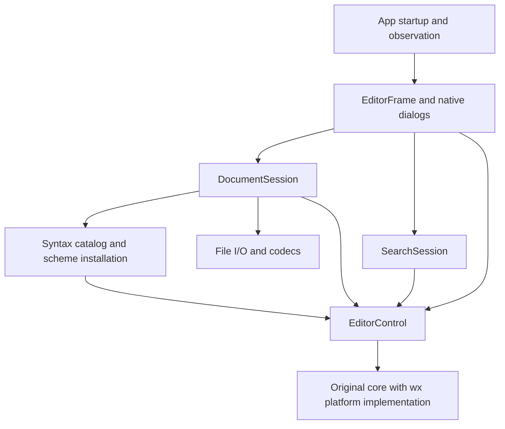

# Code structure and evolution plan

Status: implemented structure, with future extensions identified separately.
The restructuring follows the proposal committed at `6cd13eb`. Validation is
recorded in [the restructuring report](observations/architecture-refactor.md).

The original-core + wxWidgets design is retained. Search semantics, document
transitions and language definitions now live in their respective modules.
`EditorFrame` composes them and presents native UI; it does not implement the
search algorithm or own the document's language choice.

## Current structure

| Location | Current responsibility | Assessment |
| --- | --- | --- |
| `src/app/main.cpp`, `process_observer.*` | Startup/options and the opt-in process observation protocol | Observation uses the actual application's commands and exists only when requested. |
| `src/app/editor_frame.*`, `find_replace_dialog.*` | Menus, prompts, file-command coordination, title/status and modeless search UI | The frame formats search outcomes; the dialog synchronizes controls with a shared search session. |
| `src/document/document_session.*` | Path, encoding/BOM, file transactions, save point and language choice | File metadata and language transitions commit after successful operations. File I/O mechanics remain private to this module. |
| `src/document/encoding/*` | Encoding conversions, including CP936 compatibility | Tested conversions and provenance are retained; the implementations use wx conversion facilities. |
| `src/search/search_session.*` | Find/replace, match validity, zero-width progress, fold reveal and history grouping | The interface takes requests and returns structured outcomes; it creates no widgets. |
| `src/syntax/*`, `src/syntax/generated/*` | Static catalog, extension detection, lexer/style installation and generated data | Menus and installation read the same catalog. Compiled lexer sources/registration remain explicit build inputs. |
| `src/editor/editor_control.*` | wx window, core lifetime, input, selection/scrolling, clipboard, IME, notifications and fold selection repair | The existing host behavior is retained. Native implementation extraction can accompany future changes to those facilities. |
| `src/editor/platform/*` | Original platform interface, rendering/fonts/windows and portability primitives | Tightly coupled to the pinned core, behind the editor host. |
| `patches/`, `tools/build.py`, `tools/update_*_scheme.py` | Pinned source preparation, portability patch, reproducible lexer data | Keep the offline path, revision/hash checks and selective upstream reuse. |
| `tests/`, `tools/clipboard_*`, `tools/resources.py` | Real editor, native UI, disk-byte and independent-process checks | Existing native regressions remain. `feature_sessions.cpp` exercises the extracted interfaces without linking the app shell. |

The former `editor_control` application library is split into `editor_runtime`,
`editor_features` and `app_shell`. `notepad4_core` is an object target incorporated
into the runtime archive. The port uses wx facilities; the core is not a
toolkit-independent engine in this build.

Two useful properties already hold:

- The original core owns live UTF-8 text, history, the save point, selections,
  styling and fold state. There is no second wx text model.
- File operations return explicit success/cancellation/failure. Decoding happens
  before document replacement; disk writes finish before path/save-point updates.

`EditorControl::Send()` has a short C++ signature but a large interface: callers
must understand message ordering, byte positions, temporary-buffer lifetime,
regex capture validity and undo grouping. The goal is to concentrate those
protocols in feature implementations, rather than wrap every message individually.

## Module arrangement

Arrows below denote calls/dependencies, not copies of document state. All current
editor and UI operations remain on the GUI thread.



The frame remains the composition point. A separate all-purpose application
controller would mostly relocate its current responsibilities. Native menu
bindings can stay in the frame once feature algorithms and dialog construction
have their own modules.

Current source layout:

```text
src/
  app/
    main.cpp
    editor_frame.{h,cpp}
    find_replace_dialog.{h,cpp}
    process_observer.{h,cpp}
    windows.rc
  document/
    document_session.{h,cpp}
    encoding/
      gbk_codec.{h,cpp}
      utf16_codec.{h,cpp}
  search/
    search_session.{h,cpp}
    search_options.h
  syntax/
    syntax_catalog.{h,cpp}
    syntax_scheme.{h,cpp}
    generated/
      cpp_scheme_data.h
      python_scheme_data.h
      json_scheme_data.h
  editor/
    editor_control.{h,cpp}
    platform/
      wx_platform.cpp
      core_headers.h
      conversion_port.h
      intrinsics_port.h
      parallel_port.h
patches/                        # pinned core changes and source provenance
tools/                          # build, generation and measurement entry points
tests/                          # gradual organization by tested behavior
```

Directories describe responsibility, not one abstract base class or library per
directory. Related file transaction mechanics remain in `document_session.cpp`;
native IME/clipboard implementation remains in the host until work on those
facilities gives a useful reason to extract it.

## State ownership and lifetime

| State | Owner | Lifetime/rule |
| --- | --- | --- |
| Text, undo/redo, dirty/save point, EOL insertion, selection, fold visibility | Original core | One core document per existing editor window; read state through the editor. |
| Path, disk encoding, BOM, automatic/manual language choice | `DocumentSession` | Current document. New/different-path Open reset to Automatic; same-path reopen retains the choice and effective scheme. Successful first Save/Save As apply the semantic selected file type; ordinary Save retains the choice. |
| Effective language | Derived from session choice + path using the syntax catalog | The UI reads it from the session. Any last-applied style cache is internal installation state, not a second owner of the user's choice. |
| Find query, replacement, options and wrap preference | `SearchSession` | Existing window/application session; survive New/Open as they do today. The dialog edits this state rather than owning the only copy. |
| Last match, empty-match progress, revision stamps | `SearchSession` | Invalidated by relevant query/options/selection/document changes and successful document replacement. A failed/cancelled file operation does not reset them. |
| Fonts, rendered geometry, native handles, clipboard publication lifetime | Editor/platform implementation | Editor/window or native ownership lifetime. Presentation uses the same layout geometry as input and hit testing. |
| Dialog visibility/focus, menu widgets, status text | App/UI | Presentation state; never authoritative text or dirty state. |

wx parent-child ownership continues to own windows. Sessions borrow the editor;
their callbacks must be disconnected before the referenced window is destroyed.
Extracted observers stop their timer on frame destruction, preserving today's
lifecycle. Future tabs or multiple views would need a separate ownership decision;
the current structure retains the one-document window.

## Feature interfaces

### SearchSession and FindReplaceDialog

`SearchSession` contains Find, ReplaceOne, ReplaceAll and their match/progress
state, extracted from `editor_frame.cpp`. It operates on the real
`EditorControl`, uses the original matcher/formatter and returns structured
outcomes. It does not create widgets or set status-bar strings.

The interface has a small set of operations:

| Operation | Caller supplies | Caller receives |
| --- | --- | --- |
| Configure search | Query, replacement, options, wrap setting | Updated session; relevant match state invalidated |
| Find | Direction | Found/no match/invalid pattern/empty query, matched byte range and wrap status |
| Replace one | Current configured search | Whether a replacement occurred and the following search outcome |
| Replace all | Current configured search | Replacement count, whether bytes changed, or an error |

The module performs match selection and fold reveal as part of Find. Callers
should not repeat the sequence of setting core targets, validating a match,
expanding folds and scrolling the caret. Byte offsets remain UTF-8 offsets; GUI
string indices do not become document positions.

Preserve the forward scan used for backward multiline regex searches, capture
revalidation, zero-width progress, full-document replacement and no-op history
semantics. Preserve one undo group for a text-changing Replace All. Extraction
must retain these behaviors before changing an algorithm.

`FindReplaceDialog` owns its widgets and forwards requests to this same session.
F3, Shift+F3, menu items and dialog buttons share the operations. The frame formats
outcomes for the status bar; the dialog formats replacement counts. Do not build
a second search engine or copy the document into a searchable application model.

### DocumentSession as the document transition owner

Keep existing `OpenResult`/`SaveResult` meanings and the existing prompt callbacks.
Native choosers, overwrite confirmation and Save/Discard/Cancel presentation stay
in the app. File reads, decoding, write completion and save-point transitions stay
in the session. Extract file/codec mechanics into private functions only where
this makes the transaction easier to read; real temporary files remain suitable
test dependencies.

The document-local language choice belongs to the session. It exposes a
language selection operation and read-only effective-language/override state.
Successful New and different-path Open reset to Automatic; reopening the current supplied path retains the effective scheme and document language choice. First Save and Save As carry a semantic
`SaveFileType`: a specific `SyntaxLanguage` forces that document language, while
`SaveType::AllFiles` clears the override and classifies the resulting filename.
Path-only calls default to `SaveType::CurrentScheme`, resolving the effective
current language. An untitled document with default/current/selected Plain Text
uses Automatic filename classification, even after manually selecting Plain Text.
Named documents have no such exception. The frame builds catalog filters with the
current scheme first (including its current extension), other schemes deduplicated,
and All Files last; it initially selects the current type and translates the native
filter index before calling the session. Native indices never enter the session.
The same rules apply to identical paths/extensions. Ordinary Save retains the current choice
and fold/view state. Failed or cancelled operations retain the previous choice.
Syntax installation itself remains in the syntax module.

The resulting operation sequence is explicit:

1. **Open:** choose path; read/decode candidate; obtain the existing discard/save
   decision; re-read if saving changed the source; replace the document; commit
   metadata and language; invalidate old search matches; update UI.
2. **Save As:** choose destination and semantic file type; obtain any encoding-loss decision; complete
   disk replacement; retain editor text/history, commit file metadata and
   save point; apply the selected type or filename exception and install any changed
   language; update menu/status. First Save follows the same rule. Cancellation or
   write failure commits neither path nor type and cannot leak a pending selection.
3. **Choose language:** update the document choice and install its effective
   scheme; preserve bytes, selection, encoding and edit history.

The frame calls `SearchSession::ResetMatch()` after successful Open/New. A dirty-
state notification does not imply document replacement. This small coordination
keeps the search algorithm and language transition rules out of the frame.

### Static syntax catalog

A descriptor for each delivered language provides its ID/name, extension set,
lexer ID, consumed keyword lists and attributes, lexer properties, style data and
fold capability. Iterate these descriptors for the Language menu, extension
selection and scheme installation. Keep Automatic as a session choice, distinct
from Plain Text, which is an actual scheme.

Keep the table and generated data static. Preserve per-list attributes, grouped
style IDs and language-specific properties; their differences are meaningful.
The catalog should use the existing pinned sources and generation helpers.
Completion-only lists remain a separate future input.

The build still needs an explicit delivered-lexer source list and upstream lexer
registration. Document those together and verify agreement when adding a language;
runtime metadata alone cannot change what is compiled. A plugin loader or a new
code-generation framework is not needed for this catalog.

## Where later features belong

| Future work | Appropriate home and design direction |
| --- | --- |
| More languages | Add a catalog descriptor, pinned data/provenance, compiled lexer/registration and representative behavior checks. Keep window code unchanged. |
| Editing commands such as indentation, line transforms, case conversion | Add cohesive operations near the editor features; reuse original core/Notepad4 routines where suitable. Menus invoke operations that own selection and undo semantics. |
| Settings and Notepad4 import | `settings/settings_store.*` owns original INI discovery and the shared load/save lifecycle. The first slice applies Line Numbers, Word Wrap and Show Whitespace; later fields extend this store and apply through their responsible modules. Complete import and appearance migration remain future work. |
| Themes and configurable fonts | Separate lexer selection from appearance application. One appearance operation should update text styles, selection/caret/fold colors and font-dependent geometry consistently. Keep point-size and DPI behavior established by the existing tests. |
| Completion and calltips | Use original completion/word data selectively. Complete and test the native popup/list/calltip implementation before exposing the feature; current platform stubs are not a finished capability. |
| Large-file behavior | Make a measured load/styling decision in the document-opening flow, then apply it through syntax/editor operations. Keep the user's language choice distinct from any reduced-styling mode. |
| File association, external changes, drag/drop and shell integration | Add narrowly scoped native implementations when needed. Keep their policy and UI out of the core/platform drawing code. |

Settings load once before frame creation from the original `Notepad4.ini`, using
the original Windows installed/portable discovery and a documented Linux native
directory mapping. A missing file can be seeded by `Notepad4.ini-default`; missing
fields use original built-in defaults. Save Settings Now and Save Settings On
Exit share this lifecycle and preserve unrelated fields. See
[the limited settings slice](settings.md) for names and platform mapping.

The current platform implementation contains incomplete capabilities:
`WxSurface::Layout` returns null, `StartDrag`/`CreateCallTipWindow` are empty, and
popup-menu methods are stubs. Future work should complete the relevant existing
interface instead of inferring support from the compiled core. Linux IME remains
deferred; this structure proposal does not change that decision.

## Portability, build and lightweight constraints

Keep `Scintilla::Internal` implementation knowledge inside the editor port. The
existing GBK codec's private use of upstream `UniConversion.h` is a narrow utility
dependency worth retaining; do not replace proven Unicode code merely to draw a
cleaner diagram. Core public messages/types remain available to feature modules
and tests. Native IME and GTK clipboard helpers can be extracted behind small
private functions with their current lifetime and reentrancy behavior intact.

The build uses three static targets:

- **Editor runtime:** original core plus wx host/platform implementation.
- **Editor features:** document, codecs, search and syntax.
- **App shell:** frame/dialogs/observation, shared by the executable and native UI tests.

`notepad4_core` supplies object files and compile requirements to `editor_runtime`.
Core and host/platform symbols share the runtime archive, avoiding a static
archive link-order cycle. `editor_features` depends on that runtime; `app_shell`
depends on features. The direct feature test links only features/runtime. Existing
native UI tests link the shell. Source preparation still uses `tools/build.py`.

Keep wx types where useful; a toolkit-free rewrite of every session value is not
needed. Use concrete modules and functions for the current in-process code.
Introduce a substitutable interface only for a real variation with actual callers
or tests. No service container, generic event bus, universal command framework or
duplicate text/undo model is required by the current feature set.

The [phase 3 measurements](observations/syntax-README.md) observed approximately
106 MiB additional RSS for a 100 MiB C++ file when styling was enabled. Directory
and class extraction will not remove that cost. The original style buffer scales
with document bytes; opening/saving also uses whole-file temporary buffers today.
Keep temporary I/O buffers short-lived and avoid additional persistent copies.
Measure a large-file styling policy separately before choosing a threshold, a
streaming design or an upstream storage change. Switching an already-styled
document to Plain Text must not be assumed to release its allocated style buffer.

## Restructuring and verification

The restructuring followed this order; it did not add editor features:

| Step | Change | Completion evidence |
| --- | --- | --- |
| 1 | Extract `SearchSession` behind the existing UI | Literal/regex/folded-search results, progress and history regressions. |
| 2 | Extract `FindReplaceDialog` and the opt-in observer | Dialog controls, shortcuts, focus and independent-process observation protocol. |
| 3 | Introduce the catalog and move language choice to `DocumentSession` | Extension/manual/save/language-transition tests and byte-identical regenerated data. |
| 4 | Move sources and separate runtime/features/shell build targets | MSVC/GCC offline builds, native integration suites and direct feature-interface contracts. |

The existing native cases remain during this extraction. The direct feature test
checks structured results, request invalidation, no-op history and document
language transitions with an actual editor, without frame/dialog dependencies.
Further algorithmic cases can use this interface while native cases retain UI
wiring coverage. These tests still require wx initialization and a display.

Keep the three agreed verification surfaces: public editor/command state, file
operations plus independently read bytes, and independent application processes.
Retain private X11/Wayland displays and the separate native IME checks. Use the
existing test harness; adding GoogleTest is not a prerequisite for this work.

Every code-changing step gets the relevant regressions, clang-format and
clang-tidy. Run the complete integration suites after the restructuring, and
preserve logs before worktree cleanup. Resource measurements are warranted when
allocation, initialization or rendering paths change, not for every file move.

## Decisions still open

- [ADR 0001](adr/0001-wxwidgets-as-preferred-ui-toolkit.md) remains `proposed` and
  ends with prototype-era conditions. The implemented code now uses this route;
  that fact is not equivalent to validation of full text layout, accessibility,
  Linux IME or all original features. Record the eventual adoption decision with
  its remaining gaps when agreed, rather than silently changing the ADR status.
- [ADR 0002](adr/0002-preserve-editing-behavior-with-incremental-migration.md)
  supports incremental behavior compatibility and selective upstream reuse. This
  plan keeps those choices and the Windows/Linux scope.
- [ADR 0003](adr/0003-import-settings-and-support-portable-mode.md) accepts settings
  import and both configuration locations. Specific settings/schema and large-file
  policy are future product choices; this plan gives them a home without choosing
  their behavior prematurely.
